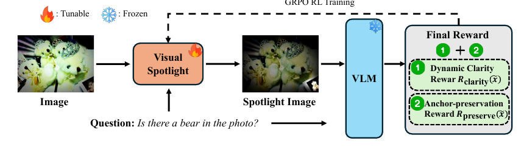
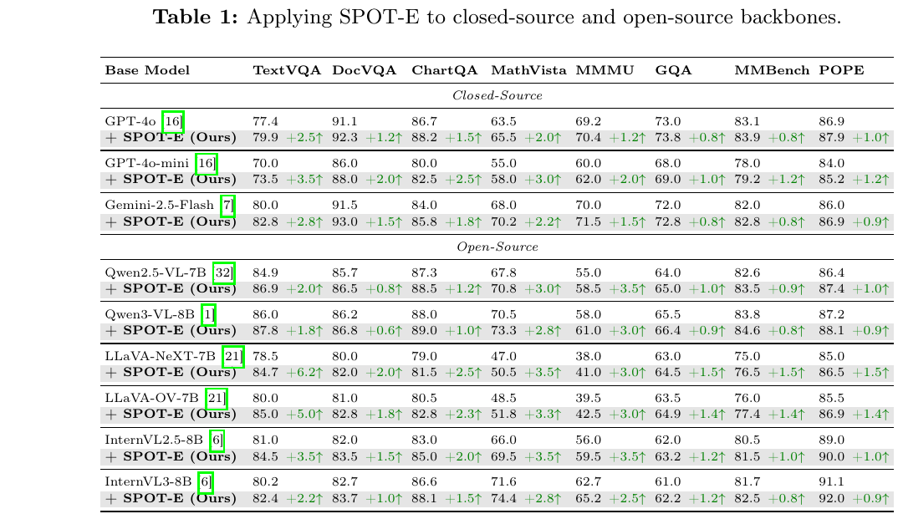
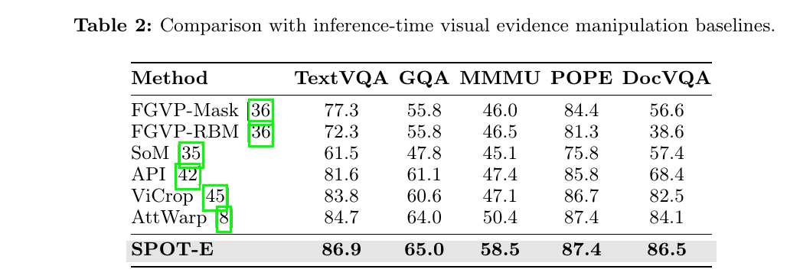

<div align="center">

# SPOT-E

**Test-Time Entropy Shaping with Visual Spotlights for Frozen VLMs**

<p>
  <a href="https://arxiv.org/abs/2606.20244">
    
  </a>
  <a href="LICENSE"></a>
</p>

<p>
  Bo Yin<sup>1</sup>, Xiaobin Hu<sup>1</sup>, Chengming Xu<sup>2</sup>, Ruolin Shen<sup>3</sup>, Mo Yang<sup>4</sup>, Jiangning Zhang<sup>5</sup>, Peng-Tao Jiang<sup>6</sup>, Cheng Tan<sup>7</sup>, Shuicheng Yan<sup>1</sup>
</p>

<p><sup>1</sup> National University of Singapore · <sup>2</sup> Fudan University · <sup>3</sup> Technical University of Munich<br>
<sup>4</sup> Sagenic Tech · <sup>5</sup> Zhejiang University · <sup>6</sup> vivo · <sup>7</sup> Shanghai Artificial Intelligence Laboratory</p>

</div>

---

## Framework

<p align="center">
  
</p>

<p align="center">
  <em>SPOT-E freezes the VLM and optimizes a lightweight visual spotlight at test time.</em>
</p>

## Setup

Linux, Python 3.12 and CUDA 12.8.

```bash
git clone https://github.com/YinBo0927/SPOT-E.git
cd SPOT-E
conda create -n spote python=3.12 -y
conda activate spote
python -m pip install --upgrade pip setuptools wheel
python -m pip install -r requirements.txt
python -m pip install -e . --no-deps
```

If Hugging Face is unreachable, set `export HF_ENDPOINT=https://hf-mirror.com` before downloading.

## Usage

**Run an example**

```bash
python run.py --image assets/example.png --question "What color is the rocket?"
```

Models download automatically. The default uses Qwen2.5-VL-7B and CLIP ViT-B/16. Results are saved to `outputs/example/` as `spotlight.png`, `mask.png`, and `result.json`.

SPOT-E adapts only visual LoRA at test time and resets it for every image. No offline training or task labels are required. Use `--phrase` to supply a compact visual phrase instead of copying it from the question with the frozen VLM.

### Configuration

Edit [`configs/default.json`](configs/default.json). Use `--config FILE` to select another configuration. Available CLI flags override JSON settings.

| Setting | Default |
| --- | --- |
| `vlm_model` / `clip_model` | Qwen2.5-VL-7B / CLIP ViT-B/16 |
| `steps` / `group_size` | 8 / 4 |
| `lora_rank` / `learning_rate` | 16 / 5e-4 |
| `anchors` / `preservation_weight` | 60 / 0.5 |
| `patch_features` / `mask_calibration` | `value_residual` / `reference` |
| `mask_temperature` / `background_brightness` | 0.7 / 0.2 |
| `noise_std` / `crop_fraction` | 0.01 / 0.6 |

For example, add `--steps 2 --group-size 2` to `run.py` for a smaller budget. Unspecified paper details and backend requirements are documented in [`docs/implementation.md`](docs/implementation.md).

### Python API

```python
from PIL import Image
from spote import SPOTE

model = SPOTE.from_pretrained()
result = model(Image.open("assets/example.png"), "What color is the rocket?")
print(result["result"]["answer"])
```

## Paper Results

<p align="center">
  <strong>Applying SPOT-E to closed-source and open-source backbones.</strong>
</p>

<p align="center">
  
</p>

<br>

<p align="center">
  <strong>Comparison with inference-time visual evidence manipulation baselines.</strong>
</p>

<p align="center">
  
</p>

## Citation

```bibtex
@article{yin2026spote,
  title={SPOT-E: Test-Time Entropy Shaping with Visual Spotlights for Frozen VLMs},
  author={Yin, Bo and Hu, Xiaobin and Xu, Chengming and Shen, Ruolin and Yang, Mo and Zhang, Jiangning and Jiang, Peng-Tao and Tan, Cheng and Yan, Shuicheng},
  journal={arXiv preprint arXiv:2606.20244},
  year={2026}
}
```
